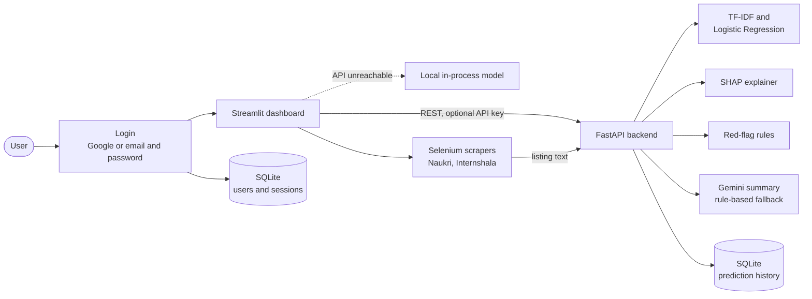
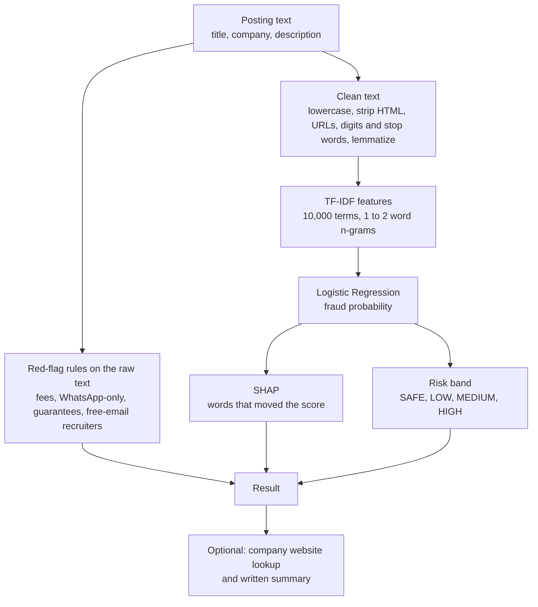
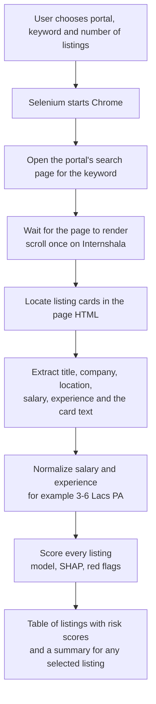
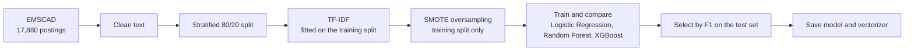

# JobGuard

Explainable fake job detection for job seekers. A machine learning model scores a job posting, SHAP and rule-based checks explain why it looks suspicious, and the result is served through a login-protected dashboard and a REST API. The dashboard can also scan live listings from Naukri and Internshala and score each one.

[](https://github.com/patilrakshita2203-prog/JobGuard/actions/workflows/ci.yml)


## Overview

Fake postings that ask for a registration fee, move candidates to WhatsApp or promise a guaranteed placement are common, and freshers are the usual target. JobGuard combines three independent signals so that a verdict is never a bare number:

1. **A trained classifier** (TF-IDF with Logistic Regression) that outputs a fraud probability.
2. **Word-level explanations** (SHAP) showing which words pushed the score up or down.
3. **Rule-based red flags** (English and Hindi keywords) for patterns such as upfront fees, WhatsApp-only hiring and free-email recruiters.

| Held-out F1 | ROC-AUC | Recall | Precision | Test set | Automated tests |
|:---:|:---:|:---:|:---:|:---:|:---:|
| 0.83 | 0.988 | 0.88 | 0.79 | 3,576 postings, 173 fraudulent | 110 |

## Features

- **Single posting analysis** with a verdict, trust score, SHAP word contributions, red flags, a written summary and a downloadable PDF report.
- **Bulk analysis** of a CSV file through the API's batch endpoint.
- **Live scanning** of Naukri and Internshala listings with Selenium (see [Live job scanning](#live-job-scanning)).
- **Salary check** that compares an offered salary with approximate reference ranges per role.
- **Skill check** that compares the skills in a posting with a small reference map for the detected role.
- **Optional company lookup** that searches the web for a website whose domain matches the company name.
- **Written summaries** from Gemini, with a deterministic rule-based fallback when no key is set or the call fails.
- **Authentication** with Google or email and password, hashed passwords, lockout and persistent sessions.
- **REST API** with OpenAPI docs, optional API key, rate limiting and upload limits.

## Architecture



The dashboard uses the API when it is reachable and otherwise loads the model itself, so the same code runs as a single deployed app or as two services.

## How a posting is scored



Risk bands follow the fraud probability: below 0.3 is SAFE, 0.3 to 0.5 LOW, 0.5 to 0.8 MEDIUM and 0.8 or above HIGH. The rules run on the raw text, not the cleaned text, because cleaning removes digits, symbols and non-English characters, which are exactly what some rules look for (amounts and Hindi keywords).

## Live job scanning

The scanner exists to test the model on real, current listings, not only on the research dataset. It collects listing cards from two portals and scores each one with the same pipeline used for pasted postings.



| Portal | Search page | What is read |
|---|---|---|
| Naukri | `naukri.com/<keyword>-jobs` | Listing cards: title, company, location, salary, experience and card text |
| Internshala | `internshala.com/jobs/<keyword>-jobs` | Listing cards: title, company, location, stipend and card text |

- **Why Selenium.** Naukri builds its result list with JavaScript, so a plain HTTP request does not return the listings, and Internshala loads more results as the page scrolls. Selenium drives a real Chrome window for both, which is why scanning only works when JobGuard runs on a machine with Chrome installed.
- **Salary and experience parsing.** Naukri writes salaries such as `3-6 Lacs PA` and hides the rupee sign in an icon. `src/scraper/naukri_parsing.py` reads the salary and experience elements and falls back to pattern matching on the card text if the page layout changes. It is covered by unit tests with realistic card HTML.
- **Scope and limits.** Between 5 and 25 listings per scan, fixed waiting times between steps, search result pages only and nothing behind a login. Listings are not saved and never used for training; the only trace is the job title and score that the API records in its prediction history, which `JOBGUARD_LOG_PREDICTIONS=false` turns off.
- **Responsible use.** Portals may restrict automated access in their terms of use. Scanning is intended for personal and educational use at low volume, and `JOBGUARD_ENABLE_SCRAPING=false` switches it off for hosted deployments.
- **Known limitation.** Only the card text is scored, which is shorter than a full posting. Scores on scanned listings are therefore less reliable than scores on a pasted description.

## Machine learning

The model is trained on **EMSCAD** (Employment Scam Aegean Dataset, [Kaggle](https://www.kaggle.com/datasets/shivamb/real-or-fake-fake-jobposting-prediction)): 17,880 postings, 866 of them fraudulent (4.84%). The training data is not scraped, and the CSV is not stored in this repository.



Results on the held-out test set (3,576 postings, 173 fraudulent):

| Model | Precision | Recall | F1 | ROC-AUC |
|---|:---:|:---:|:---:|:---:|
| **Logistic Regression (deployed)** | 0.785 | 0.884 | **0.832** | 0.988 |
| Random Forest | 0.922 | 0.682 | 0.784 | 0.986 |
| TF-IDF and BERT embeddings with Logistic Regression (experiment) | 0.655 | 0.890 | 0.755 | 0.983 |

Logistic Regression catches 153 of the 173 scams and raises 42 false alarms on 3,403 genuine postings. It has the best F1 of the three, ahead of the Random Forest and the TF-IDF and BERT experiment, and it is fast and exactly explainable. An XGBoost run is stored in `models/training_results.json` but is excluded here: it was affected by a mismatch between dense training input and sparse evaluation input, which is fixed in `src/ml/model_training.py` and covered by a regression test, and the saved numbers have not been regenerated yet.

## Explainability and red flags

- **SHAP** is computed against an empty posting as the baseline, so every word shown is a word that is actually in the text.
- **Rule-based flags** cover upfront payments, guaranteed jobs or income, WhatsApp or Telegram hiring, requests for sensitive documents or bank details, investment or crypto, no interview, pressure tactics, unrealistic earnings, free-email recruiters and giveaways. Each flag shows the matching phrase.
- **Why both exist.** The classifier learned from an older, mostly US dataset, so it has absorbed some wrong associations for Indian postings, for example that "whatsapp" leans genuine. The rules catch the patterns the model under-weights, so the dashboard shows the red flags next to the model verdict.

## Authentication

- Sign in with **Google** (Streamlit's built-in OpenID Connect) or with an **email and password**.
- Passwords are stored only as salted scrypt hashes. Five wrong attempts lock an account for 15 minutes, and unknown emails and wrong passwords return the same message.
- "Keep me signed in" uses a random session token in a browser cookie. Only a hash of the token is stored on the server.
- To enable Google, create an OAuth client in the [Google Cloud Console](https://console.cloud.google.com/), add `http://localhost:8501/oauth2callback` as a redirect URI and put the keys in `.streamlit/secrets.toml` (git-ignored):

```toml
[auth]
redirect_uri = "http://localhost:8501/oauth2callback"
cookie_secret = "any-long-random-string"
client_id = "xxxx.apps.googleusercontent.com"
client_secret = "xxxx"
server_metadata_url = "https://accounts.google.com/.well-known/openid-configuration"
```

## REST API

Interactive documentation is served at `/docs`.

| Endpoint | Purpose |
|---|---|
| `POST /predict` | Score one posting: verdict, probability, trust score, SHAP words, red flags |
| `POST /predict/batch` | Upload a CSV with a `description` column and receive it back with predictions |
| `POST /analyze` | Facts, red flags and a written summary for one posting |
| `GET /stats` | Training metrics |
| `GET /history` | Recent predictions logged by the API |
| `GET /health` | Liveness, model status and whether Gemini is configured |

```bash
curl -X POST http://127.0.0.1:8000/predict \
  -H "Content-Type: application/json" \
  -d '{"title": "Work From Home", "description": "Registration fee of Rs 500 required. Contact on WhatsApp."}'
```

## Tech stack

| Area | Tools |
|---|---|
| Machine learning | scikit-learn, imbalanced-learn (SMOTE), SHAP, NLTK; sentence-transformers and XGBoost for experiments |
| Backend | FastAPI, Pydantic, Uvicorn, SQLite |
| Dashboard | Streamlit, Plotly, ReportLab (PDF) |
| Data collection | Selenium, Beautiful Soup |
| Language model | Google Gemini with a rule-based fallback |
| Quality | pytest (110 tests), GitHub Actions |

## Getting started

Tested with Python 3.12 (the version used in CI). Chrome is needed only for live scanning.

```bash
git clone https://github.com/patilrakshita2203-prog/JobGuard.git
cd JobGuard
python -m venv venv
venv\Scripts\activate            # macOS and Linux: source venv/bin/activate
pip install -r requirements.txt
copy .env.example .env           # macOS and Linux: cp .env.example .env
```

Start the two services in separate terminals:

```bash
uvicorn main:app --reload        # API at http://127.0.0.1:8000/docs
streamlit run app.py             # dashboard at http://localhost:8501
```

Open the dashboard and choose **Create account** the first time. A Gemini key in `.env` is optional. Without it the written summary is generated by rules.

Run the tests with `pip install pytest httpx` followed by `pytest -q`. They run offline: no Gemini key, web search or Chrome is needed.

To retrain, install the training packages listed at the top of `requirements.txt`, place `fake_job_postings.csv` in `data/` and run `python -m src.ml.model_training`.

## Configuration

Set these in `.env` or the environment. `.env.example` lists all of them.

| Variable | Default | Meaning |
|---|---|---|
| `GEMINI_API_KEY` | none | Enables Gemini summaries |
| `JOBGUARD_API_URL` | `http://127.0.0.1:8000` | Where the dashboard finds the API |
| `JOBGUARD_MODE` | `auto` | `auto` uses the API if reachable, `api` requires it, `local` never calls it |
| `JOBGUARD_API_KEY` | none | If set, the API requires an `X-API-Key` header |
| `JOBGUARD_AUTH_REQUIRED` | `true` | Set `false` to skip the login page while developing |
| `JOBGUARD_ENABLE_SCRAPING` | `true` | Set `false` on hosts without Chrome |
| `JOBGUARD_RATE_LIMIT` | `60` | API requests per minute per IP |

## Project structure

```
JobGuard/
├── app.py                     Streamlit dashboard
├── main.py                    FastAPI backend
├── src/
│   ├── config.py              Settings from environment variables and Streamlit secrets
│   ├── api_client.py          Dashboard to API client
│   ├── auth/                  Login page and user store
│   ├── preprocessing/         Text cleaning
│   ├── ml/                    Vectorizer, SMOTE, training scripts, predictors
│   ├── explainability/        SHAP, red flags, rule engine, company lookup, Gemini, skill check
│   ├── reporting/             PDF report
│   └── scraper/               Naukri and Internshala scrapers, card parsing
├── models/                    Trained model, vectorizer and metrics
├── sample_data/jobs.csv       Example file for bulk analysis
├── screenshots/               Images used in this README
├── tests/                     pytest suite
└── .github/workflows/ci.yml   Runs the tests on every push
```

## Deployment

**Dashboard on Streamlit Community Cloud.** Create an app from this repository with `app.py` as the main file. Under Secrets, set `GEMINI_API_KEY`, `JOBGUARD_ENABLE_SCRAPING = "false"` and the `[auth]` block shown above with the redirect URI `https://<your-app>.streamlit.app/oauth2callback`. Without an API the dashboard runs the model itself.

**API on Render (optional).** Create a web service with build command `pip install -r requirements.txt`, start command `uvicorn main:app --host 0.0.0.0 --port $PORT` and health check path `/health`. Set `GEMINI_API_KEY`, `JOBGUARD_API_KEY` and `JOBGUARD_CORS_ORIGINS`, then point the dashboard at it with `JOBGUARD_API_URL` and the same `JOBGUARD_API_KEY`.

Email and password accounts are stored in a local SQLite file, which hosted platforms with temporary disks reset on restart. Use Google sign-in there, or set `JOBGUARD_AUTH_DB_PATH` to a persistent disk.

## Limitations and future work

- **Dataset age and language.** EMSCAD is older, mostly English and US-centred. Scam patterns common in India differ, which is why the rule-based layer exists. The next step is to retrain on labelled Indian postings.
- **Short input on scanned listings.** The scanner scores card text, not the full posting. Fetching each listing's detail page would improve the score at the cost of more requests.
- **Evaluation.** The best model is selected on the test set, so the reported F1 is slightly optimistic, and near-duplicate postings in the dataset may appear on both sides of the split. A separate validation split and a duplicate-aware split are planned. The saved model was trained before TF-IDF fitting was moved to the training split only; retraining applies the change.
- **Few positives.** 866 fraudulent postings in total, 173 in the test set, so metrics carry noticeable variance.
- **Portal changes.** Scraper selectors depend on the portals' page structure and may need updates.
- **Account recovery.** There is no password reset email yet.
- **Planned.** Per-user history, a validation set of hand-labelled Indian scam messages to measure the rule layer, and calibrated decision thresholds.

JobGuard is an educational project, not a verdict. Always verify an employer through its official channels and report fraud at [cybercrime.gov.in](https://cybercrime.gov.in).
